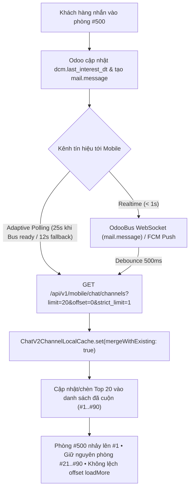

# SPEC: Tối Ưu Tốc Độ Tải Danh Sách Chat V2, Polling Hợp Nhất (Merge), Tương Thích Đa Phiên Bản Odoo 17/19 & Trạng Thái Kết Nối

> **Mã tài liệu:** `SPEC-CHAT-V2-FAST-SYNC-2026-11-25` (Revision `v2.0` — Audited Odoo 17/19 & PostgreSQL Safe)  
> **Dự án:** VCloud Mobile App (`vclients` Flutter) & Odoo Backend (`v_mobile_17`, `v_mobile_19`)  
> **Trạng thái:** `DRAFT v2.0 — CHỜ ANH TÂN DUYỆT (Gate B)`  
> **Ngày cập nhật:** `2026-11-25`  
> **Tham chiếu quy chuẩn:** `AGENTS.md`, `docs/RULE_ODOO_VERSIONS.md`  
> **Phạm vi:** Hotfix `v_mobile_17`, Chat V2 Pagination & `mergeTop`, OdooBus Message Hint, Adaptive Polling, Sync Status Banner, Backend Light Payload & Cursor Delta Sync

---

## 1. Bối Cảnh & Phân Tích Nguyên Nhân Gốc Rễ (Root-Cause Analysis — `VERIFIED`)

### 1.1. Hiện tượng (Symptom) & Tái hiện (Reproduction)
- Trên iPhone thật (Wi-Fi/5G bình thường) và máy ảo Redroid kết nối tài khoản có lượng hội thoại lớn (VD: tài khoản nhân sự ~**956 cuộc trò chuyện**, gồm hàng trăm kênh Zalo OA / Livechat / CSKH):
  1. Màn hình **Trò chuyện (Chat V2)** thường xuyên bật banner vàng **`⚠️ Đang ngoại tuyến — Chạm để thử lại`** dù mạng bình thường.
  2. Lần mở đầu tiên hoặc khi kéo làm mới phải chờ lâu mới tải xong danh sách hội thoại.

### 1.2. Chuỗi bằng chứng kỹ thuật từ mã nguồn (`Trace & Evidence — VERIFIED`)

| # | Tầng ảnh hưởng | Tọa độ mã nguồn (`VERIFIED`) | Nguyên nhân gốc rễ (Root Cause) |
| :-: | :--- | :--- | :--- |
| **RC-1** | **Backend Odoo 17 (`v_mobile_17`)** | `v_mobile_17/controllers/chat.py:288-303`, `:371`, `:762`, `:770`, `:1004`, `:1031` | Hàm `list_channels()` trên `v_mobile_17` **thiếu khai báo biến `is_portal_user`** (trong khi `v_mobile_19/controllers/chat.py:291-295` đã có). Hệ quả: (a) Dòng `371` ném `NameError` trong `try...except` làm mất kênh chưa đọc ngoài top `limit`; (b) Dòng `762, 770, 1004, 1031` nằm ngoài `try` con ➔ chỉ cần danh sách có **1 kênh `livechat` hoặc `is_cskh_channel`** là nổ **`NameError` ➔ HTTP 500**, khiến Mobile hiểu nhầm thành `"Đang ngoại tuyến"`. |
| **RC-2** | **Backend SQL (`v_mobile_17` & `19`)** | `controllers/chat.py:332-414`, `:454`, `:491` | (a) Khi `offset == 0` (cả lúc mở app lẫn lúc polling ngầm), Backend tự chạy thêm 2 câu SQL cộng dồn **toàn bộ kênh chưa đọc (`unread_ch_ids`) + toàn bộ kênh `channel`** bất chấp `limit` ➔ tài khoản có 400 phòng Zalo cũ chưa đọc vẫn phải xử lý >400 phòng mỗi chu kỳ polling.<br>(b) Subquery `EXISTS (SELECT 1 FROM mail_message ... 45 days)` và 4 lần chạy regex `body ~* '(cuộc gọi|call duration|kéo dài trong)'` quét TOAST table trên bảng `mail_message` lớn gây tốn CPU/Disk I/O.<br>(c) `v_mobile_17` dòng `247` còn gọi cứng `env.cr.commit()` giữa request `GET` trong `_touch_presence()`. |
| **RC-3** | **Mobile Polling & Cache (`vclients`)** | `chat_v2_channels_controller.dart:935`, `:970`, `:1037`, `:1093` & `chat_v2_list_screen.dart:168-174` | (a) `build()`, `refresh()` và `_executeResumeRefresh()` đều tải `limit: 80` lặp lại mỗi **8 giây/lần**.<br>(b) `ChatV2ListScreen.initState()` gọi chồng `resumeRefresh()` cùng lúc với `build()` gây **Double API Call** ngay khi mở màn hình.<br>(c) Khi resume từ background trên iOS, gọi API ngay lập tức trước khi OS khôi phục socket TCP gây `SocketException` giả. |
| **RC-4** | **Mobile Error Mapping & Bus (`vclients`)** | `chat_v2_channels_controller.dart:984-1003`, `chat_v2_list_screen.dart:2887`, `odoo_bus_service.dart:90-91`, `:170-285` | (a) `_isTransientError(e)` gộp mọi lỗi Timeout 25s và HTTP `500/502/503/504` thành `ChatV2SyncStatus.offline` (`"Đang ngoại tuyến"`).<br>(b) `OdooBusService` gán `_isConnected = true` trước khi `await _channel!.ready` và mới chỉ bắt sự kiện RTC Call/Mute/Nickname, **chưa bắt sự kiện tin nhắn mới (`mail.message`)** để báo cho danh sách chat cập nhật tức thì. |

---

## 2. Mục Tiêu Nghiệm Thu & Cam Kết An Toàn Hệ Thống (Target KPIs & Safety Guarantees)

| Chỉ số | Hiện tại | Mục tiêu sau tối ưu |
| :--- | :---: | :---: |
| Lỗi HTTP 500 `is_portal_user` trên Odoo 17 | Xảy ra khi có kênh Livechat/CSKH | **0 lỗi** (đồng bộ 100% `v_mobile_17` & `v_mobile_19`) |
| Số kênh tải lần đầu (`build` / Pull-to-Refresh) | `80` + toàn bộ unread không trần | **`30` kênh** (trần an toàn, phản hồi **< 1.5s** cho ~956 chats) |
| Số kênh tải khi polling ngầm | `80`+ kênh mỗi `8s` | **Đúng `20` kênh (`strict_limit=1`)** mỗi **`25s`** khi Bus sống (hoặc <10ms với Delta Sync Pha 2) |
| Tin nhắn mới ở phòng `#500+` | Phải chờ chu kỳ poll 8s | **Nhảy lên `#1` trong < 1–2s** qua OdooBus Hint / FCM Push + `mergeTop(20)` |
| Phòng cũ đã cuộn tới (`#31..#90`) khi polling / bấm Ghim / Mute | Bị cắt mất về 30 kênh | **Giữ nguyên 100%** nhờ `mergeWithExisting: true` & bỏ `refresh()` thừa |
| Tác động lên Odoo Discuss Web & PostgreSQL | ~7.5 req/phút/user + quét TOAST `mail_message` | **Giảm 70–85% tải HTTP worker & I/O DB**, 0 lock bảng hệ thống, 100% tương thích ngược JSON Contract |

---

## 3. Sơ Đồ Luồng Đồng Bộ Hợp Nhất (Realtime Bus + Adaptive Polling + `mergeTop`)



---

## 4. Pha 0 (Hotfix Bắt Buộc Trên `v_mobile_17` — An Toàn Tuyệt Đối, Minimal Diff)

> [!IMPORTANT]
> Cần thực hiện ngay cùng hoặc trước Pha 1 để triệt tiêu lỗi HTTP 500 trên `vuahethong.net` (Odoo 17 Production) mà không thay đổi bất kỳ JSON contract nào.

1. **Bổ sung khai báo `is_portal_user` trong `list_channels()` (`v_mobile_17/controllers/chat.py:291`):**
   - Khai báo đồng bộ y hệt `v_mobile_19/controllers/chat.py:291-295`:
     ```python
     is_portal_user = bool(
         getattr(user, "share", False)
         or user.has_group("base.group_portal")
         or not user.has_group("base.group_user")
     )
     ```
   - Kiểm tra an toàn `"is_internal" in request.env["mail.message"]._fields` trước khi ghép mệnh đề `AND (m.is_internal IS NOT TRUE)` trên Odoo 17.
2. **Loại bỏ `env.cr.commit()` thủ công giữa request `GET` trong `_touch_presence()` (`v_mobile_17/controllers/chat.py:247`):**
   - Đồng bộ theo đúng chuẩn của `v_mobile_19/controllers/chat.py:242`: Để Odoo HTTP dispatcher tự commit khi kết thúc request thành công, tránh ngắt transaction snapshot giữa chừng hoặc giữ lock không cần thiết trên worker chính.

---

## 5. Thiết Kế Kỹ Thuật — Pha 1: Tối Ưu App Mobile (`vclients` Flutter)

### 5.1. Phân tách `limit` & Quản lý `_serverLoadedCount` chống nhảy cóc `offset`
- **File:** `lib/features/chat_v2/application/chat_v2_channels_controller.dart`
- Hằng số phân trang:
  - `const int kInitialChannelsLimit = 30;` (dùng cho `build()` lần đầu và kéo tay `refresh()`).
  - `const int kPollingChannelsLimit = 20;` (dùng cho `_executeResumeRefresh()` khi polling ngầm / nhận tín hiệu Bus).
  - `const int kLoadMoreChannelsLimit = 30;` (dùng cho `loadMore()` khi cuộn xuống đáy).
- **Quản lý biến `int _serverLoadedCount = 0;` độc lập với `current.length`:**
  - *Lý do:* `ChatV2ChannelLocalCache.cached` có trộn thêm `_pinnedDirectChannels` (các kênh 1-1 ghim local nằm sâu dưới `#300`) và kết quả tìm kiếm (`_onSearchChanged`). Nếu truyền `offset: current.length` sẽ làm nhảy cóc mất các kênh ở ranh giới trang.
  - Khi `build()` / `refresh()` tải trang đầu: `_serverLoadedCount = fresh.length;` và `_hasMore = fresh.length >= kInitialChannelsLimit;`.
  - Khi `loadMore()` gọi `offset: _serverLoadedCount, limit: kLoadMoreChannelsLimit`: tăng `_serverLoadedCount += nextItems.length;` và cập nhật `_hasMore = nextItems.length >= kLoadMoreChannelsLimit;`.
  - Khi `mergeTop(20)` chèn thêm `K` kênh hoàn toàn mới chưa từng có trong tập server đã tải: cộng bù `_serverLoadedCount += K` (hoặc deduplicate theo `id` ở trang kế tiếp) để không bỏ sót bất kỳ kênh nào.

### 5.2. Cơ chế `mergeWithExisting` & Chặn mất kênh khi Ghim / Tắt chuông / Mở màn hình
- **File:** `lib/features/chat_v2/application/chat_v2_channels_controller.dart` & `lib/features/chat_v2/presentation/screens/chat_v2_list_screen.dart`
1. **Mở rộng `ChatV2ChannelLocalCache.set(List<ChatV2Channel> channels, {bool fromServerFullList = false, bool mergeWithExisting = false})`:**
   - Khi `mergeWithExisting == true` (áp dụng cho **Polling ngầm `limit: 20`**, **`loadMore()`**, và **Search merge**):
     - Giữ lại **100% các kênh đang có trong `_cached`** (VD: 60 hoặc 90 kênh anh Tân đã cuộn tới), bỏ giới hạn chỉ giữ kênh `< 24h`.
     - Ghi đè dữ liệu mới nhất cho các kênh trùng `id` (vẫn bảo vệ `Instant Cache Preservation` nếu tin local mới hơn API) và thêm mới các kênh chưa có trong `_cached` (VD: phòng `#500` vừa có tin mới nhảy lên `#1`).
     - Sắp xếp đồng nhất tại một nơi duy nhất: Kênh ghim (`_userPinnedIds` theo `_userPinnedOrder`) lên đầu ➔ các kênh còn lại sắp theo `lastMessageDate DESC`.
   - Khi `mergeWithExisting == false` (chỉ áp dụng khi **`build()` lần đầu chưa có danh sách đầy đủ** hoặc người dùng **chủ động kéo tay Pull-to-Refresh `refresh()`**):
     - Làm mới từ top `30` kênh (vẫn bảo toàn các kênh `unreadCount > 0` vừa nhận realtime) và đặt lại `_hasMore = true`.
2. **Xóa lệnh gọi `refresh()` thừa sau khi bấm Ghim / Tắt chuông (`chat_v2_list_screen.dart:2716`, `:2735`, `:2741`):**
   - Hiện tại menu ngữ cảnh gọi `ChatV2ChannelLocalCache.toggleUserPin(...)` / `setUserMuted(...)` rồi gọi tiếp `notifier.refresh()` làm bay mất các kênh `#31..#90` đã cuộn. Thay bằng cập nhật state trực tiếp từ `ChatV2ChannelLocalCache.cached` (0 network reload).
3. **Chặn Double API Call lúc mở màn hình (`chat_v2_list_screen.dart:168-174`):**
   - Trong `resumeRefresh()`, nếu `state.isLoading || _isResumeRefreshing` thì `return` ngay để không bắn song song 2 request `getChannels()` đè lên `build()`.

### 5.3. Nối Sự Kiện Tin Nhắn Mới Vào `OdooBusService` & Nhịp Polling Thích Ứng
- **File:** `lib/features/chat_v2/data/odoo_bus_service.dart` & `chat_v2_channels_controller.dart`
1. **Xác thực kết nối WebSocket thật (`odoo_bus_service.dart:90`):**
   - Chờ `await _channel!.ready;` thành công rồi mới đặt `_isConnected = true` (tránh báo `isConnected = true` ảo khi socket chưa bắt tay xong hoặc mạng rớt).
2. **Lắng nghe tín hiệu tin nhắn mới đa phiên bản Odoo 17 & 19 (`odoo_bus_service.dart`):**
   - Trong `_processBusNotification(item)`, bổ sung bắt sự kiện tin nhắn mới gửi tới kênh `res.partner_<myPartnerId>`:
     - `type == 'discuss.channel/new_message'` (Odoo 17/19)
     - `type == 'mail.record/insert'` có payload chứa `'Message'` (Odoo 17) hoặc `'mail.message'` (Odoo 19)
   - Phát sự kiện qua `Stream<int?> onChannelActivityHint` ➔ `ChatV2ChannelsNotifier` lắng nghe và debounce `500ms` để gọi `_executeResumeRefresh()` (`mergeTop(20)`).
3. **Nhịp Polling Thích Ứng (`_scheduleNextPoll`):**
   - Khi `busService.isConnected == true`: giãn nhịp polling định kỳ thành **`Duration(seconds: 25)`** (tin mới vẫn nhảy tức thì `< 1s` nhờ `onChannelActivityHint` / FCM Push).
   - Khi `busService.isConnected == false`: giữ nhịp dự phòng **`Duration(seconds: 12)`**.

### 5.4. Chống Đứt Socket Giả Khi Resume (iOS/Android) & Cơ Chế Silent Retry
- **File:** `lib/features/chat_v2/application/chat_v2_channels_controller.dart`
- Khi `isAppForegroundProvider` chuyển `false ➔ true`:
  - Hủy timer cũ, chờ **`400ms`** để iOS/Android khôi phục định tuyến mạng trước khi gọi `resumeRefresh()` và kết nối lại `busService.connect()`.
- **Graceful Silent Retry (Không nháy banner lỗi giả khi đã có cache):**
  - Nếu trong bộ nhớ đang có sẵn danh sách hội thoại (`cached.isNotEmpty`), khi lần gọi ngầm đầu tiên gặp lỗi tạm thời, giữ nguyên danh sách trên màn hình (không bật banner vàng ngay), âm thầm retry tối đa 2 nhịp ngắn (`2s`, `4s`). Chỉ khi cả loạt retry đều thất bại mới hiển thị Banner cảnh báo tương ứng.

### 5.5. Phân Loại 3 Trạng Thái Banner & Bảo Toàn UX Bộ Lọc Danh Mục (Filter Chips)
- **File:** `chat_v2_channels_controller.dart` & `chat_v2_list_screen.dart`
1. **Mở rộng `enum ChatV2SyncStatus` & helper `classifySyncError(Object error)`:**
   - `synced`: Ẩn banner.
   - `connecting`: `"Đang đồng bộ..."` (chỉ hiện khi kéo làm mới chủ động hoặc chưa có cache).
   - `offline`: Lỗi mạng vật lý (`SocketException`, `Failed host lookup`, `Network is unreachable`, `Connection refused`, `HandshakeException` do captive portal) ➔ **`"Đang ngoại tuyến — Chạm để thử lại"`**.
   - `serverTimeout`: Quá thời gian chờ (`TimeoutException`, HTTP `504`, `408`) ➔ **`"Máy chủ phản hồi chậm — Chạm để thử lại"`**.
   - `serverError`: Lỗi máy chủ (`500`, `502`, `503` hoặc JSON `{"error": "server_error"}`) ➔ **`"Máy chủ tạm gián đoạn — Chạm để thử lại"`**.
2. **Bảo toàn hiển thị Chip lọc (`Tất cả`, `Chưa đọc`, `Zalo OA`, `Zalo`, `Hỗ trợ`...):**
   - Khi chưa có `category_counts` từ Pha 2 mà `_hasMore == true`, hiển thị nhãn đếm trên chip `Tất cả` dạng `30+` (hoặc tổng từ metadata khi có Pha 2) để không gây hiểu nhầm chỉ có 30 cuộc trò chuyện.
   - Khi người dùng bấm vào một chip danh mục cụ thể (`_selectedFilterKey != null` và khác `'unread'`), nếu số kênh khớp trong RAM `< 15` và `_hasMore == true`, tự động gọi bổ sung `repo.getChannels(filter: _selectedFilterKey, limit: 30)` rồi `mergeWithExisting: true` vào cache để danh mục đó luôn hiển thị đủ dữ liệu.

---

## 6. Thiết Kế Kỹ Thuật — Pha 2: Tối Ưu Backend (`v_mobile_17` & `v_mobile_19`)

*(Triển khai đồng bộ trên nhánh task riêng cho `17.0` và `19.0` theo `docs/RULE_ODOO_VERSIONS.md`, đảm bảo **100% tương thích ngược** với app cũ và 246+ bài test hiện hữu)*

### 6.1. Bảng Ma Trận Tương Thích Cứng Giữa Odoo 17 và Odoo 19 (Cấm Copy Mù Quáng)

| Thành phần kỹ thuật | Odoo 17 (`v_mobile_17` — Nhánh `17.0`) | Odoo 19 (`v_mobile_19` — Nhánh `19.0`) |
| :--- | :--- | :--- |
| Decorator `@http.route` | **KHÔNG** truyền `readonly=False` | **BẮT BUỘC** có `readonly=False` |
| Trạng thái Ghim / Ẩn kênh | Dùng cột `dcm.is_pinned` (`boolean`) | Dùng `dcm.unpin_dt`, `dcm.last_interest_dt`, `dc.last_interest_dt` (`is_pinned` là `store=False`) |
| Cột `last_interest_dt` | **CHỈ CÓ** trên `discuss_channel_member` (`dcm.last_interest_dt`), **CẤM** gọi `dc.last_interest_dt` | Có trên cả `dcm.last_interest_dt` và `dc.last_interest_dt` |
| Bảng Presence | `bus_presence` (qua `_get_presence_table`) | `mail_presence` (qua `_get_presence_table`) |
| Lọc ghi chú nội bộ Portal | Kiểm tra `"is_internal" in request.env["mail.message"]._fields` trước khi ghép SQL | Có sẵn `m.is_internal IS NOT TRUE` |
| JSON REST API Contract | **Giống nhau 100% từng tên trường và kiểu dữ liệu** | **Giống nhau 100% từng tên trường và kiểu dữ liệu** |

### 6.2. Tối Ưu SQL Chống Chậm PostgreSQL (0 Table Lock, 0 Full TOAST Scan)
1. **Tham số `strict_limit=1` (cho Polling ngầm) & Trần an toàn khi `offset=0`:**
   - Khi Mobile gửi `strict_limit=1` (dùng trong polling `limit=20`): Bỏ qua 2 câu SQL phụ cộng dồn toàn bộ `unread_ch_ids` và `public_ch_ids`, chỉ lấy đúng top `20` kênh hoạt động mới nhất từ Index của `discuss_channel_member` (`< 3ms`).
   - Khi tải lần đầu (`offset=0` không có `strict_limit`): Đặt `LIMIT 50` cho query `unread_ch_ids` mới nhất thay vì lấy không giới hạn hàng trăm kênh Zalo cũ.
2. **Loại bỏ Subquery `EXISTS` quét `mail_message` 45 ngày ở câu SQL chính:**
   - Thay đoạn `EXISTS (SELECT 1 FROM mail_message mm WHERE ... 45 days)` ở dòng `332-343` bằng điều kiện trực tiếp trên bảng đã JOIN:
     `COALESCE(dcm.last_interest_dt, dc.write_date, dc.create_date) >= (now() at time zone 'UTC' - interval '45 days')`
   - Hiệu quả: Chạy 100% trên `discuss_channel_member` + `discuss_channel`, loại bỏ hàng trăm lần lặp SubPlan + regex `~*` trên bảng `mail_message`.
3. **Thu hẹp phạm vi Regex `body ~*` & dọn Query trùng:**
   - Với các kênh `dcm.seen_message_id IS NULL` (chưa từng mở đọc), giới hạn đếm unread trong cửa sổ `m.date >= (now() at time zone 'UTC' - interval '45 days')` và chỉ đánh giá regex khi `m.message_type = 'user_notification'`.
   - Xóa câu SQL `mute_until_dt` bị lặp lần 2 (mục `2.2` trùng với mục `2.05` trong `chat.py`) và xóa key `"is_muted"` bị khai báo trùng trong dict JSON.
4. **Hỗ trợ tham số `filter=<category>` tại tầng SQL:**
   - Đọc `kw.get("filter")` (`chat`, `channel`, `zalo_oa`, `zalo`, `livechat`, `unread`) để lọc trực tiếp trước khi `LIMIT`, giúp bấm vào bất kỳ chip lọc nào trên Mobile cũng trả về đúng các kênh của danh mục đó ngay lập tức.

### 6.3. Chế Độ Light Payload (`compact=1`) — Bảo Toàn 100% Avatar 1-1, Zalo & CSKH
- Khi truyền `compact=1`:
  - **Đối với kênh Nhóm / Phòng ban (`channel_type in ('channel', 'group')`):** Không query danh sách thành viên preview và trả `"members": []` (vẫn giữ nguyên `member_count`).
  - **Đối với kênh Chat 1-1 (`chat`), `zalo`, `zalo_oa`, `livechat`, `cskh`:** Vẫn lấy đúng **1 đối tác đại diện** (`partner_id != partner.id`) để dựng đầy đủ `channel_name`, `avatar_url`, `im_status` và `direct_partner` — đảm bảo **không bị mất tên khách hàng hay mất avatar** trên danh sách chat, đồng thời giảm 70–80% kích thước JSON payload.

### 6.4. Cursor Delta Sync (`after_msg_id` + `since`) & Metadata `with_meta=1` (100% Tương Thích Ngược)
1. **Cursor Delta Sync chính xác (Không dùng `dc.write_date` đơn độc):**
   - Hỗ trợ query param tùy chọn `after_msg_id=<int>` và `since=<ISO-8601-UTC>`.
   - Chỉ truy vấn các kênh của user thỏa mãn:
     - Có tin nhắn mới `EXISTS (SELECT 1 FROM mail_message m WHERE m.model = 'discuss.channel' AND m.res_id = dc.id AND m.id > %s)` (Index Seek `< 1ms` trên PK), **HOẶC**
     - `GREATEST(COALESCE(dcm.last_interest_dt, '-infinity'), COALESCE(dcm.write_date, '-infinity'), COALESCE(dc.write_date, '-infinity')) > %s` (bắt trọn cả thay đổi đọc tin, mute, đổi tên kênh, thêm thành viên).
   - Nếu không có kênh nào thay đổi ➔ trả ngay mảng rỗng trong `< 10ms`.
2. **Bảo toàn 100% JSON Contract cũ với cờ tùy chọn `with_meta=1`:**
   - **Mặc định (không truyền `with_meta=1`):** Trả về `List [...]` y hệt hiện tại ➔ không ảnh hưởng các bản Mobile cũ và toàn bộ test contract hiện có.
   - **Khi truyền `with_meta=1`:** Trả về JSON Object:
     ```json
     {
       "channels": [ ... ],
       "meta": {
         "total_count": 956,
         "unread_channels_count": 14,
         "category_counts": {
           "chat": 25,
           "channel": 12,
           "zalo_oa": 890,
           "zalo": 24,
           "livechat": 5
         },
         "max_message_id": 1284920,
         "server_time": "2026-11-25T09:00:00Z"
       }
     }
     ```

---

## 7. Kế Hoạch Kiểm Thử 4 Lớp (4-Layer Verification Plan)

### Layer 1 — Static Analysis
- Frontend (`vclients`): `flutter analyze` đạt **0 errors, 0 warnings**.
- Backend (`v_mobile_17` & `v_mobile_19`): `python3 -m py_compile controllers/chat.py` đạt **PASS 100%**, kiểm tra không rò rỉ `dc.last_interest_dt` hay `readonly=False` sang `v_mobile_17`.

### Layer 2 — Automated Unit & Contract Tests
- **Flutter (`test/features/chat_v2/chat_v2_fast_sync_merge_test.dart`):**
  1. Cache đang có 60 kênh ➔ polling `mergeTop(20)` có kênh `#500` mới nhắn ➔ kết quả có 61 kênh, kênh `#500` nhảy lên vị trí `#1` (sau các kênh ghim), giữ nguyên kênh `#21..#60`.
  2. Kiểm chứng `_serverLoadedCount`: có 5 kênh `_pinnedDirectChannels` + 30 kênh trang đầu ➔ `loadMore()` gọi đúng `offset: 30` (không nhảy cóc lên `35`).
  3. Bấm Ghim / Tắt chuông kênh `#55` không làm mất các kênh `#31..#60`.
  4. `classifySyncError`: `SocketException` ➔ `offline`, `TimeoutException` / `504` ➔ `serverTimeout`, `HTTP 500/502/503` ➔ `serverError`.
  5. `OdooBusService`: nhận `mail.record/insert` (`Message` Odoo 17 & `mail.message` Odoo 19) phát đúng `onChannelActivityHint`; adaptive polling trả về `25s` khi Bus connected và `12s` khi disconnected.
- **Backend Odoo 17 & Odoo 19 (`test_chat.py`, `test_chat_search_and_channels_contract.py`):**
  1. Test `list_channels` với tài khoản có kênh `livechat` & `is_cskh_channel` trên Odoo 17 trả HTTP `200 OK` (0 lỗi `NameError: is_portal_user`).
  2. Test `strict_limit=1&limit=20` trả đúng `<= 20` kênh; `compact=1` vẫn trả đủ `avatar_url` & `direct_partner` cho kênh 1-1 và Zalo; mặc định không có `with_meta=1` trả `list`, có `with_meta=1` trả `dict` chứa `meta.category_counts` và `meta.max_message_id`.
  3. Test `after_msg_id` chỉ trả đúng kênh vừa có tin nhắn mới.

### Layer 3 — Runtime Verification (Redroid & Docker `demo-17` / `demo-19`)
- Đo thời gian tải lần đầu `< 1.5s` trên tài khoản ~956 cuộc trò chuyện.
- Cuộn tải thêm 3 trang (`90` kênh), bắn tin nhắn mới vào phòng `#500` ➔ phòng `#500` nhảy lên `#1` trong `< 2s`, các kênh `#31..#90` giữ nguyên không mất.
- Kiểm chứng tắt Wi-Fi hiện `"Đang ngoại tuyến"`, giả lập lỗi 500 hiện `"Máy chủ tạm gián đoạn"`, giả lập timeout hiện `"Máy chủ phản hồi chậm"`.

### Layer 4 — Production Runtime Verification (`vuahethong.net` & `demo.vuahethong.com`)
- Kiểm chứng thực tế trên iPhone của anh Tân sau khi deploy theo đúng pipeline MR/PR trong `docs/RULE_ODOO_VERSIONS.md`, đối chiếu `EXPLAIN ANALYZE` trên PostgreSQL đảm bảo 0 query chậm và 0 ảnh hưởng tới Odoo Discuss Web.
